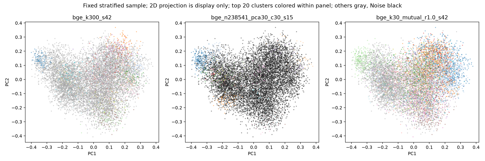
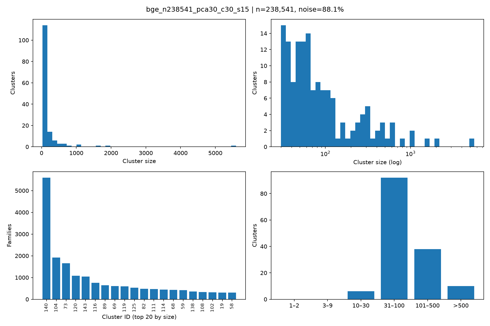

# A5.5-D1｜FUJIFILM全库 Query-Free 聚类与初步技术目录

日期：2026-10-25。输入为已完成的238,541族BGE-M3与Qwen3-Embedding-0.6B向量；没有重编码、关键词筛选、引用/IPC特征、历史核心种子或人工移动成员。全部工作与输出位于核验UUID的SSD独立目录。56个主实验已实际完成，另有两个大型社区的局部细分。

**主要结论：全库存在可用的领域、对象、材料和部分方法族结构，但Cluster不能直接当技术路线。** sym Leiden适合上层导航，mutual能保留有价值的小群，同时产生大量孤点。HDBSCAN能找密度小群，却把全部45个历史观察族标为Noise。LLM能给出初步主题，但“引文逐字存在”仍不足以保证共通技术手段成立。

## Q1 三种算法形成多少群

以下为主要设置；56次完整参数与种子结果在 [comparison/run_statistics.csv](comparison/run_statistics.csv) 及统计工作簿。

|实验|族数|非空群|单点|≥3族群|Noise|中位规模|最大规模|
|---|---|---|---|---|---|---|---|
|bge_k100_s42|238541|100|1|98|0.0%|2344.500|5679|
|bge_k300_s42|238541|300|4|294|0.0%|786.000|2487|
|bge_k800_s42|238541|796|61|699|0.0%|222.000|2040|
|qwen_k300_s42|238541|300|0|300|0.0%|761.500|2446|
|bge_n238541_pca30_c30_s15|238541|146|0|146|88.1%|67.000|5593|
|bge_k30_mutual_r1.0_s42|238541|7120|6438|238|0.0%|1.000|15185|
|bge_k30_sym_r1.0_s42|238541|32|0|32|0.0%|5335.500|27556|
|qwen_k30_mutual_r1.0_s42|238541|5173|4575|273|0.0%|1.000|13073|
|qwen_k30_sym_r1.0_s42|238541|41|0|41|0.0%|4481.000|22621|
|bge_n50000_pca30_c10_s5|50000|155|0|155|84.0%|19.000|1084|

这些是特定模型、输入空间和参数下的分区数，没有唯一“天然技术数量”。K值、图规则、分辨率、PCA和密度阈值都会改变结果。特别是BGE mutual的7120群中6438是单点，不能称作7120条路线。K=800仅796个非空群。HDBSCAN的全库146群与50k样本155群有不同分母，不能混为全库结果。

## Q2 形成的是哪一层技术

实际结构是混合的：

- K=300 Cluster 18（212族）同时含感射线树脂、嵌段共聚物自组织和处理液。材料体系、图案形成方法与辅助化学品并存。
- BGE sym Cluster 16（5294族）包含导光读取结构、图像显示过程、接收方列表及其他对象，属于应用/对象区域。
- Qwen K=300 Cluster 228（29族）围绕黑白热显影感光材料，但粒子外延、位错、乳胶、银盐和多层配方仍是不同手段。
- BGE mutual Cluster 134（5族）已接近“利用断层图像提取荷电粒子飞迹”的方法族；其内部也有中心定位、端部定位和多图选择差别。

15条具名候选均增加了“证据支持层级”和“共同手段核查说明”，见技术工作簿与 [TECHNOLOGY_CATALOG.md](TECHNOLOGY_CATALOG.md)。不能把同一材料或同一应用当成同一工艺。

## Q3 哪种更容易分出具体手段

在本轮实际案例中，**Leiden非平凡小群和局部细分更适合继续追查方法族**，但尚不能据有限、非均匀语义抽样宣布全库的绝对赢家。5族飞迹提取是正例；17族水耕系统仍包含不同子手段。HDBSCAN的92族电荷传输群和323族纤维素酰化物膜群，主要是器件/材料体系，并非单一机制。

细粒度K=800的57族压电群能让盲测模型识别压电对象与可靠性目标，却把氧18、Nb组成和Pb比例等不同策略合在一起。它说明更细能改善对象聚焦，不能证明一个群就是一条Recipe。此例来自事后检查，未计入首轮自然发现。

## Q4 哪种对小众技术有帮助

本次最清楚的两个可调查小群来自mutual Leiden：

1. **5族断层图像/荷电粒子飞迹提取**：三份原文分别涉及最大对比度层定位、按黑点数估计记录层端部、从多张断层图选择含潜像黑点的两图。它们支持一个具体方法族，尚不是完全相同算法。
2. **17族果菜水耕栽培与光照系统**：原文涉及湛液式水耕、人工光与反射结构、水耕架等。它是本次Query-Free选样显露的目录线索，和喷头关系分开判定，未因应用不同而删除。

|案例|Family ID|代表公开号|原始标题|
|---|---|---|---|
|飞迹提取|google:72642920|JP2020159896A|情報処理装置、情報処理方法、及び情報処理プログラム|
|飞迹提取|google:72643036|JP2020160022A|情報処理装置、情報処理方法、及び情報処理プログラム|
|飞迹提取|google:75157643|JP2021051013A|情報処理装置、情報処理方法、及び情報処理プログラム|
|水耕系统|google:97139098|WO2025197628A1|Cultivation device for fruit vegetable plant, and cultivation method for fruit vegetable plant|
|水耕系统|google:99972696|JP2026091069A|Cultivation methods for fruit and vegetable plants|
|水耕系统|google:97138839|WO2025197286A1|Apparatus for cultivating fruiting plant, and method for cultivating fruiting plant|

这些是值得进一步阅读的真实专利群，不是“新发明”或趋势已证实的结论。完整摘要见 [comparison/rare_case_patents.csv](comparison/rare_case_patents.csv)。

HDBSCAN 50k样本的(10,5)配置有105个10–30族群；本轮未证明这些小群都是独立技术。稀有区域清单有2329条记录，类型、实验分母、双模型近邻和数据质量标记分开保存。小群、Noise、标题缺失与重复文本不能混成“无关”。

## Q5 Embedding模型是否影响结构

影响明显：全库Top30近邻平均重合45.1%；同K=300跨模型ARI 0.351、NMI 0.685。BGE/Qwen sym在相同k=30、resolution=1时分别32/41群。

|分区A|分区B|ARI|NMI|
|---|---|---|---|
|bge_k300_s42|bge_k300_s137|0.461|0.762|
|qwen_k300_s42|qwen_k300_s137|0.485|0.776|
|bge_k30_mutual_r1.0_s42|bge_k30_mutual_r1.0_s137|0.739|0.859|
|bge_k30_sym_r1.0_s42|bge_k30_sym_r1.0_s137|0.841|0.885|
|qwen_k30_sym_r1.0_s42|qwen_k30_sym_r1.0_s137|0.764|0.847|
|bge_k300_s42|qwen_k300_s42|0.351|0.685|
|bge_k30_mutual_r1.0_s42|qwen_k30_mutual_r1.0_s42|0.422|0.669|
|bge_k30_sym_r1.0_s42|qwen_k30_sym_r1.0_s42|0.433|0.643|

历史Recipe观察族在Qwen K=300中25/27同群，而BGE K=300分成11群；换用mutual Leiden，BGE又把27族集中一群，Qwen分成4群。相对集中程度取决于模型和算法，不能据一个交集数字断言语义质量。

同K=300语言NMI为BGE 0.218、Qwen 0.166；sym为0.338与0.119。Qwen在这些设置的语言关联较弱，但NMI受群数、文本长度和语料分布影响。两模型原始余弦尺度也不可直接排名。未沿用过去Top20检索结论预设优劣。

## Q6 LLM能否可靠命名

本地qwen3-coder:30b（Q4_K_M，digest 06c1097e…）实际完成70群的Query-Free首轮及独立喷头关系第二轮，输入/原始输出均保存。首轮112次主题尝试中，模型原本给出48个名称、64次主动待定；每主题至少3族可核引文的保守门槛保留15条具名，另外33个原名转为待定，总待定97条。原名没有删除，**这不是命名准确率或技术发现Recall**。

296条原始引文中，273条在实际发送片段的声明字段逐字存在（92.2%）；18条无逐字匹配，2条字段错配，2条为空，1条虽在完整源文存在却不在发送片段。所有计数按实际输入hash复核，见 [evidence/quote_audit_summary.json](evidence/quote_audit_summary.json)。

更重要的是语义：

- 正确保留不确定：13族“開閉式画像形成装置”代表只有标题，模型没有编造具体手段。
- 层级可用：感射线树脂、光热成像材料等名称可作为材料目录，但不能把不同配方合并。
- 引文真、机制不成立：BGE sym Cluster 0的颜色校正候选，把真实的颜色校正摘要与真实的A/D控制、锁相环标题当作共同证据。三段都存在，却不能支持同一颜色校正机制。
- 部分支持：嵌段共聚物候选有两份自组织证据，第三份google:52468210完整摘要是电子束/EUV曝光与有机溶剂显影，不能作为嵌段共聚物的第三份支持。

因此LLM可辅助提出主题和提示异质性，**不能自动把Cluster转为可靠技术路线**。已对15条具名候选逐条阅读证据并标注支持层级/风险；这是Codex证据抽查，不是人工Gold。模型自评、逐字核查和共同机制核查分别呈现。第二阶段喷头关系属于独立模型推断，未唯一匹配或首轮待定者不输出确定关联。

## Q7 Sputter Recipe与设备路线在空间里如何分布

45个E4观察族全部在输入底座。BGE mutual使27个Recipe族集中一个4255族群，Equipment在另外3群；Qwen sym使Recipe在2群、Equipment在另2群。它们对这份观察子集有区分能力，但不能据此推断全群纯度或全部路线正确。

**HDBSCAN全库45族全部Noise。** 这是一条明确反例：Noise不等于无技术价值。H04/H16仍无已解析族；H06/H12仍保留“候选成员已核验、历史代表关系未定”状态，未伪造映射。

首轮命名后才读取历史树，并另做8群不提示历史名称的事后盲测。宽泛6群没有形成可核验共同名称；细K=800能识别压电对象和可靠性目标，但仍混合具体策略。事后选群不能算首轮Query-Free发现。

详见 [HISTORICAL_TREE_CHECK.md](HISTORICAL_TREE_CHECK.md)，其中分开报告：族在群中、群有共同机制、模型识别路线三种结论。

## Q8 是否发现值得调查的潜在技术

有真实目录线索：5族飞迹提取方法族和17族水耕系统，以及光热成像材料、感射线树脂等材料体系。前两者给出小群与原文证据，说明全库探索可以显露预先未输入的主题。此处“值得调查”指有可读证据和明确对象/子手段，未做新颖性、商业价值或趋势判断，不为达到数量把15个名称称作15条新路线。

## Q9 下一阶段主算法

建议采用**Leiden分层导航 + mutual小群补充**，保留MiniBatchKMeans独立粒度对照。sym作为领域/对象根层；在大型社区内部重建局部图，再看实际子机制，不把调整全局resolution当作唯一细分方式。两个最大BGE群15185/11963族已局部细分16/15群，局部Recall@15约99.9%，155条中心/边缘/随机原文代表见 [comparison/local_cluster_representatives.csv](comparison/local_cluster_representatives.csv)。这些局部子群未逐一冒充已命名路线。

HDBSCAN作为密度核心/Noise审计工具，保留所有Noise；不作全库入口删除器。模型继续保留BGE/Qwen两视图，当前语义抽样不足以锁定唯一模型。技术知识库下一步应建立专利—技术候选多标签、对象—问题—手段—效果及逐条证据关系，而不是Cluster ID直接当Technology ID。

## Q10 是否需要引用与IPC/CPC

值得做独立后验对照，但没有证据表明必须立刻融合。实际不足是语言/长度关联、仅标题、材料/功能混机制、稀有族被密度法排为Noise，以及单条代表文本不能完整表达全族。引用或IPC可能补充关系，也可能只强化领域/时间偏差；应围绕这些具体案例验证增益。当前已完成实验没有把它们作为特征。

## 方法和资源限制

原始代表文本保留229994条标题+摘要、8537条仅标题、10条仅摘要；完全重复代表文本1146组、相同摘要370组均未删除或合并法律族。族内其他成员/语种没有在本轮重新编码，60个原底座不可编码族不进入238541分母。

PCA保留30/50维方差约40.9%/50.4%（BGE），不能视作同等语义保留：

|模型|PCA维数|原始Top20邻居保留|
|---|---|---|
|bge|30|36.3%|
|bge|50|48.3%|
|qwen|30|39.5%|
|qwen|50|50.0%|

近似图另有128固定查询的精确对照：

|模型|efSearch|Recall@15|Recall@30|Recall@50|
|---|---|---|---|---|
|bge|160|98.0%|98.6%|98.5%|
|qwen|160|97.6%|99.1%|98.6%|

这里的Recall是近邻索引指标，不是技术发现Recall。没有构造全库N×N密集矩阵。二维图只展示固定分层样本，不定义原始距离真值：

主机实际16GiB Mac，聚类用CPU；重任务开始时串行，按实测内存允许至多两个低内存独立进程有界重叠。全库HDBSCAN核心过程约19.4分钟，观测峰值约0.49GiB；最大图阶段观测峰值约2.78GiB。PCA、索引构建和共享图预处理另计，不能把单次partition耗时当全部建图成本。HDBSCAN的146个持久性全为1，已查到119重合PCA向量与实现的无穷密度回退分支，不作“完美稳定”证据。

算法版本、具体预处理差异、欧氏MiniBatchKMeans与严格球面方法的区别、抽样和指标分母见 [reports/METHODS.md](reports/METHODS.md)。没有运行新BQ/EPO/全量编码，没有改服务器配置、原始库、向量或人工标签。

## 交付与复核

- [CLUSTER_ASSIGNMENTS.parquet](data/cluster_assignments)：11044345行、56实验；45个实验为全库，11个为固定样本。每行族ID、行号、标签和分母已全部回读对照冻结数组，原输入与标签保持不变。
- 统计工作簿：56个实验、181组一致性比较、8张图结构诊断。
- 聚类工作簿：主比较分区14163群、533条代表原文；最大20群实际ID另在 [comparison/largest20_clusters.csv](comparison/largest20_clusters.csv)。
- 技术工作簿：112次主题尝试，15条具名/97条待定；273条可核原文引用；模型原名、支持层级与共同手段说明并列。
- 稀有审查工作簿：2329条小群、Noise、边界与模型分歧记录，数据质量标记独立保留。
- [ALGORITHM_COMPARISON.md](ALGORITHM_COMPARISON.md)、[HISTORICAL_TREE_CHECK.md](HISTORICAL_TREE_CHECK.md)、[TECHNOLOGY_CATALOG.md](TECHNOLOGY_CATALOG.md)。
- figures/：12幅实际静态图；scripts/、configs/requirements.lock.txt：复现代码与25个独立依赖版本锁；EXPERIMENT_MANIFEST.json：输入、模型、代码、参数、种子和交付hash。
- 四份Excel保存在 /Volumes/Fuji_SSD_Work/workspaces/a55_d1_query_free_clustering/outputs/01a171fb-0dd6-7792-b36b-80e200aba942。它们是实验快照，修改表内数值不会自动重跑聚类。

所有结果来自实际执行。阶段Gate和检查记录在evidence/；目录是初步技术候选，不是最终技术树。主要误差来自粒度混合、代表文本、降维与模型归纳，已以真实失败案例保留。
